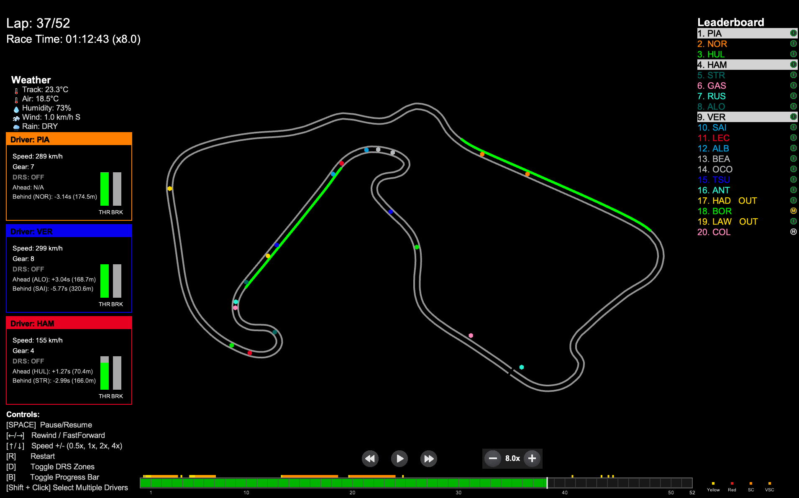

# F1 Race Replay 🏎️ 🏁

A full Formula 1 telemetry replay engine. Unlike the single-session demo on the
`sample` branch, this build runs **every session, fully**: pick any race
weekend from any supported season in the GUI and replay the complete session
with real telemetry downloaded from the FastF1 API.



## What it does

- **Full season access:** Race, Qualifying, Sprint and Sprint Qualifying
  sessions across all supported seasons (2018–present) — not just one demo race.
- **Session selection GUI:** launch the app and a Qt window lists every race
  weekend; click a session and the replay starts.
- **Real telemetry:** driver positions, speed, throttle, brake, gear, DRS and
  tyre data come from the official F1 data feed via FastF1, resampled to 25 FPS
  frames and cached locally for instant replay.
- **Full HUD:** live leaderboard with tyre compounds, session info, weather,
  lap counter, progress bar, race controls and an on-screen legend.
- **Interactive playback:** pause, rewind, fast-forward, variable playback
  speed (0.1x → 256x), restart, DRS zone and label toggles, driver selection.
- **Safety car visualization:** animated SC deploy/return based on real track
  status data.
- **Insights menu:** launches alongside the replay with telemetry analysis
  windows — driver telemetry, lap time evolution, tyre strategy, track
  position, race control feed and a pit wall template.
- **Telemetry stream server:** broadcasts live replay telemetry over TCP
  (localhost:9999) in a JSON format documented in [telemetry.md](./telemetry.md),
  so external tools can consume the stream.

## How to run

```bash
python -m venv venv
venv/bin/pip install -r requirements.txt
venv/bin/python main.py
```

A session-selection window opens; pick a year, a race weekend and a session.

Useful CLI flags:

```bash
venv/bin/python main.py --viewer --year 2026 --round 12          # race, skipping the GUI
venv/bin/python main.py --viewer --qualifying                    # qualifying
venv/bin/python main.py --viewer --sprint                       # sprint
venv/bin/python main.py --list-rounds                           # list weekends for a season
venv/bin/python main.py --refresh-data                          # force telemetry recompute
```

## Controls

- **Space** — pause / resume
- **← / →** — rewind / fast-forward (hold)
- **↑ / ↓** — playback speed (0.1x → 256x)
- **1–4** — set speed directly (0.5x / 1x / 2x / 4x)
- **R** — restart replay
- **D** — toggle DRS zones
- **B** — toggle progress bar
- **L** — toggle driver labels on track
- **H / click Help** — show controls popup
- **Click a driver on the leaderboard** — select / shift+click multi-select
- **Esc** — close

## Where the data lives

| Path | What it is |
|------|-----------|
| `.fastf1-cache/` | raw FastF1 cache per session (offline-capable once downloaded) |
| `computed_data/*.pkl` | precomputed 25fps frame telemetry per session (loads instantly) |

Both are gitignored. On a fresh clone the app downloads what it needs on first
viewing of a session (requires network), then replays instantly afterwards.
Delete the caches (or run with `--refresh-data`) to force a recompute.

## Development

```bash
venv/bin/pip install -r requirements-dev.txt
venv/bin/python -m pytest
```

Tests never open GUI windows, OpenGL contexts or download data — CI runs them
headless with `MPLBACKEND=Agg` (see `.github/workflows/tests.yml`).
